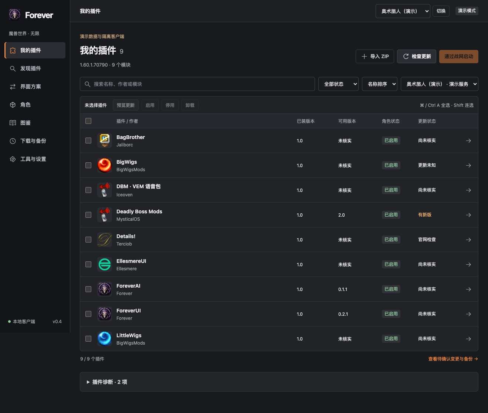
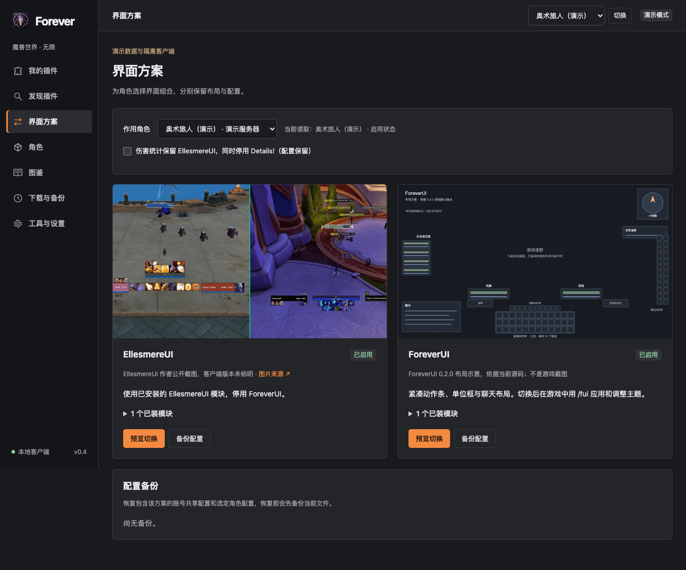
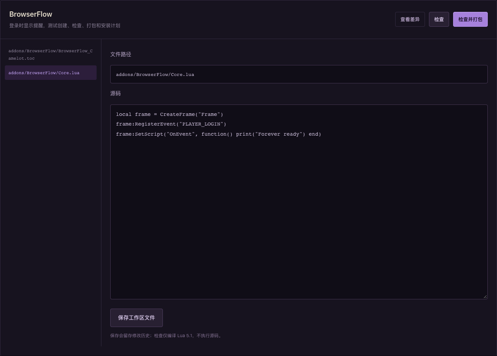

<p align="center">
  
</p>

<h1 align="center">Forever</h1>
<p align="center"><strong>为 macOS 定制的一站式魔兽插件助手</strong></p>
<p align="center">插件管理 · 交互行囊 · 图鉴 · 界面方案 · 备份与恢复</p>
<p align="center">A macOS-first, all-in-one addon companion for WoW Forever.</p>

<p align="center">
  
  
  
  
</p>

把插件管理、界面切换和离线开发放进一个 Mac 窗口。

**Forever for Mac** 面向国服《魔兽世界：无限》玩家：接管已有插件，检查作者更新，预览每次变更，备份后应用；再把 Codex、Claude Code 或 Cursor 接进本地开发工作台。角色装备、可交互行囊、专业和任务已整合为标签页，图鉴支持分类、分页与材料跳转。

> 当前为 **[v0.4.2 源码预览版](https://github.com/a13602888637-dot/forever-mac/releases/tag/v0.4.2)**。已在 Intel Mac 验证；Apple Silicon 可编译，尚未完成实机验收。只支持国服《无限》，游戏内加载与战斗保护仍需人工验收。Mac App 仍依赖源码目录，本次不提供独立安装包。



## 为 Mac 玩家准备了什么

| 你要做的事 | 在 Forever 里怎么做 |
| --- | --- |
| 从助手进入游戏 | **通过战网启动**，沿用战网登录态，再点击“进入游戏” |
| 接管已有插件 | 识别 `_forever_`，按插件包组织模块，显示版本、依赖、来源与兼容信息 |
| 检查与更新 | 搜索、筛选和多选插件，汇总预览后串行应用，失败停止并恢复失败项 |
| 按角色管理 | 明确选择存档角色后启停、检查依赖；卸载保留 SavedVariables |
| 找回更新前的状态 | 安装历史、失败恢复与回滚，备份保留在 AddOns 外 |
| 换一套界面 | 按角色选择 EllesmereUI / ForeverUI，分别保留配置，独立备份与恢复 |
| 让 AI 帮写插件 | 创建或复制到离线工作区，编辑、看差异、检查 Lua、打包、生成安装计划 |
| 直接问 Codex | 奥术问答复用本机已登录的 Codex，未保存角色快照也能先问插件与界面问题 |
| 查看角色和资料 | 完整装备槽位；行囊搜索、分类、排序、详情和比较；图鉴分页、材料与产物跳转 |


### v0.4 的日常管理

默认打开“我的插件”。发现目录只列具体项目，图标和公开截图保留[素材来源](docs/MEDIA-SOURCES.md)；EllesmereUI 截图版本未明确时原样标注，ForeverUI 采用明确标记的布局示意。

安装、启停、卸载与恢复均先展示具体变更。恢复预览绑定当前文件状态，期间发生修改时需要重新预览。下载阶段和实际字节保留在“下载与备份”，操作不依赖停留在当前页面。

行囊可以按名称、分类、品质和位置筛选，点击查看数量、属性和图鉴；可穿戴候选直接比较当前槽位。比较绑定页面快照，自动同步或切换角色后不会静默比较另一物品。移动、使用和穿戴物品仍在游戏中完成。

图鉴支持 `wowf` 与旧缓存。公开市场使用 `auction_house` 只读数据，必须由用户选择市场；超过24小时、来源不可靠或随机属性报价不参与当前收益计算。

### 副本、地图与任务

发现目录可查看 Atlas 核心和地图包、Atlas Forever、DBM 地下城首领模块、Questie、DungeonJournal。每项保留作者来源、Forever 支持依据和核对日期；添加到目录不代表已安装或完成游戏内验收。Atlas 核心、地图包和 DBM 地下城模块沿用作者发布校验与安装预览；其他项目从官网选择 Forever ZIP 后导入。

图鉴可浏览副本、首领、区域地图和任务。副本页列首领顺序、入口与副本任务，任务页显示正文、目标、前后置任务与位置。仅有编号的任务保留线索，QuestieDB 补充与近似坐标单独标注。首领与副本页可查看掉落物品，物品页支持反查首领。Spyglass 的《无限》参考掉落与 QuestieDB 的经典旧世参考分别标注，未知掉率保持未知。当前资料库没有地下城内部地图和已核实的首领技能攻略；内部地图可查看发现目录中的 Atlas 类项目。公开数据缓存与角色任务进度相互独立。

### Mac 原生窗口，战网负责登录

使用 AppKit + WKWebView 独立窗口，保留菜单、快捷键和应用图标。重复打开复用本地服务。

首页“通过战网启动”打开已安装的 Battle.net。选择《无限》并点击“进入游戏”，使用战网已有登录态。插件准备与更新可以在战网打开时继续；游戏运行后暂停实际替换。

### 每次更新都能看清、找回

- **按包管理**：EllesmereUI、DBM、LittleWigs 等的模块归在一起，避免几十个目录分别变成更新任务。
- **核对真实声明**：优先读取 `_Camelot.toc`，并检查作者发布清单的 Forever / Interface 16001 声明。
- **保留本地修改**：接管时记录文件哈希，内容变化后暂停覆盖，可以先复制到工作区保留修改。
- **暂存检查**：ZIP 先进入隔离区，检查越界路径、符号链接、大小写冲突、异常体积和文件引用。
- **备份与恢复**：多目录更新共用操作锁与记录；失败恢复，意外退出后可继续恢复。

首批作者来源：**DBM、EllesmereUI、LittleWigs**，另支持 BigWigs 依赖修复。CurseForge 提供官网入口和 ZIP 导入；没有获批 API 授权时明确显示“需官网检查”。

### 两套界面，各自保留习惯

EllesmereUI 组合启用已装模块、停用 ForeverUI；ForeverUI 组合只停用功能重叠的 EllesmereUI 模块。正常切换仅调整选定角色的启用状态，不转换布局，不改动其他插件。

配置备份与恢复是独立操作。ForeverUI 0.2.2 为动作条图标与文字换肤，保留游戏原生动作条布局和显隐；其他模块提供下方对称单位框及更安静的聊天与地图布局。首次使用进入角色运行 `/fui`，点击“应用亡灵奥术”；“紧凑布局”只调整其他模块，动作条位置使用游戏原生编辑模式。

动作条外的悬浮技能冷却默认隐藏，可用 `/fui icons on` 显示、`/fui icons off` 隐藏；任务特殊技能按钮保留。新布局保留上一套位置，可用 `/fui layout undo` 找回。界面组合还可选择保留 EllesmereUI DPS 统计，并停用 Details! 及附属模块，配置不会删除。



### 接上已有 AI 工具，做自己的插件

开发工作台提供完整离线路径：

**需求 → 创建或复制插件 → 修改工作区 → 检查 Lua → ZIP → 安装计划 → 在平台应用**

本地 MCP 使用官方 Python SDK 与 `stdio`，提供 16 项工具。AI 默认修改副本；读取和修改限制在插件源码与工作区内。Lua 5.1 只编译，不执行第三方源码。API 查询附带公开资料版本，未命中保留待验证状态。

不需要为开发工作台额外配置模型 API Key。你可以继续使用已有的 Codex、Claude Code 或 Cursor，在工作台复制 MCP 的 `command` / `args` 进行连接。



## 问答接入本机 Codex

本机安装并登录 Codex CLI 后，Mac 应用的“问答”可以直接调用现有登录。没有角色快照时可先问插件、界面和操作步骤；角色装备与进度仍以游戏保存的快照为准。

默认 `FAI_AI_PROVIDER=auto`：优先使用已有 OpenAI API 配置，否则使用已登录的本机 Codex。可选值为 `auto` / `codex` / `openai` / `rules`。本次验证使用 Codex CLI 0.166.0。

Codex 问答使用独立临时目录、只读沙箱与结构化输出，关闭工具、MCP、插件和 hooks，不改写 Codex 全局配置；发送前移除角色名和服务器名。问答会调用模型服务，工作台与规则功能仍可离线使用。

## 在 Mac 上运行

需要 macOS 12+、[uv](https://docs.astral.sh/uv/getting-started/installation/)；构建原生 App 还需要 Xcode Command Line Tools。

```bash
git clone https://github.com/a13602888637-dot/forever-mac.git
cd forever-mac
uv sync --extra dev
uv run python scripts/build_macos_app.py
open "Forever AI Companion.app"
```

再次构建时，脚本先完成新 App 的编译与签名验证，再将本项目内的旧 App 归档到 `delete/<时间批次>/` 并替换入口，归档清单保留旧版本位置。正在运行的 App 不移动；构建失败保留旧入口。版本号读取 `pyproject.toml`。

也可以直接打开本地网页入口：

```bash
./启动.command
# 离线演示，不接管实际客户端：
./启动.command --demo
```

启动默认只扫描，安装和更新由你在平台点击应用。自动优先发现 `/Applications/World of Warcraft/_forever_`；非标准路径可通过 `WOW_PATH` 指定。服务只监听 `127.0.0.1`，没有开机启动项或系统计划任务。

首次使用采集插件时，在平台准备并应用 ForeverAI 的安装计划，重启游戏后启用。角色数据在游戏正常退出或手动 `/reload` 后落盘，助手读取最近一次存档。

## 开发与验证

```bash
uv run pytest -q
uv run ruff check backend tests scripts
uv run python addons/ForeverUI/selfcheck/run.py
uv run foreverai mcp-serve --mode live
```

验证覆盖多目录更新、恶意 ZIP、本地修改保护、失败与中断恢复、组合往返、真实 stdio MCP 客户端以及战网启动入口。桌面与窄屏交互、Intel App 启动和服务复用也已检查。游戏内加载、布局、动作条与战斗保护单独进行人工验收。

| 目录 | 内容 |
| --- | --- |
| `backend/` | 插件管理、事务、界面组合、工作台、MCP 与原助手服务 |
| `frontend/` | 桌面管理、角色、行囊和图鉴页面 |
| `native/macos/` | AppKit / WKWebView 客户端 |
| `addons/` | ForeverAI 只读采集与独立 ForeverUI |
| `tests/` | 隔离客户端与接口回归 |
| `scripts/` | 启动、安装、原生构建与验证入口 |

配置说明见 [.env.example](.env.example)，原助手细节见 [使用指南](docs/COMPANION_GUIDE.md)，接口见 [API](docs/API.md)，验证边界见 [验证记录](docs/VERIFICATION.md)。

## 当前边界

- 当前聚焦 **macOS + 国服《无限》**。不是 Blizzard 官方产品，不承诺其他服系或 Windows 的兼容性。
- 不注入游戏进程，不在游戏中远程执行 Lua，不自动操作角色或交易。
- CurseForge 官方 API 授权尚未接入实际配置；官网文件支持可由用户确认，界面会标注来源。
- API 缓存版本可能早于客户端，界面保留版本差异和需要游戏内验证的行为。
- 本次提供源码构建，没有把本机账号、SavedVariables、数据库、运行日志或模型密钥放进仓库。

## 来源与致谢

- [无限图鉴](https://wuxianwow.com/about)与[公开 API 资料](https://wuxianwow.com/api/)：内置公开物品/配方资料与 API 缓存，保留原始来源和版本；不包含玩家存档。
- [Model Context Protocol Python SDK](https://github.com/modelcontextprotocol/python-sdk)：本地 MCP 服务。
- [HTMX](https://htmx.org/)：原助手页面交互，随附 [许可证](frontend/static/HTMX-LICENSE.txt)。
- 各插件由其作者维护，作者发布 ZIP 只在用户选择后下载，仓库不附带第三方插件安装包。

欢迎在 [Issues](https://github.com/a13602888637-dot/forever-mac/issues) 反馈 Mac 使用问题。提交日志时请移除账号、角色存档和密钥。
