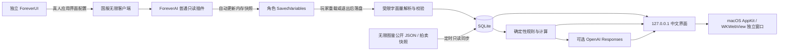

# 架构与自动化

## 两个插件

ForeverAI 和 ForeverUI 独立启停，均使用角色级 SavedVariables。ForeverAI 从客户端允许访问的 API 读取个人状态，使用显式 JSON null 哨兵序列化；不发送游戏指令。ForeverUI 的安全单位按钮与原生动作按钮仍由真人点击和按键触发。布局和受保护配置只在脱战后调整；模块初始化失败恢复对应原生界面。

ForeverAI 同时包含由公开 JSON 生成的完整离线物品/配方数据表。生成器只输出转义后的 Lua 字面量，校验版本、数量和记录 ID，原子替换文件。该表只用于资料查询，不进入角色快照，不由后端执行。

macOS 客户端使用 AppKit 创建真实窗口，在 WKWebView 内显示同一中文界面。启动过程直接调用本项目入口，以最小 GUI PATH 寻找 uv，验证本地健康接口后加载；重复打开复用本项目服务。内嵌页面导航限制在当前本地服务，用户主动点击的外部资料链接交给系统浏览器。

采集事件合并约 5 秒，战斗中延后，登出时再尝试保存内存快照。不调用 ReloadUI，不模拟输入，不读取进程内存，不建立外部执行 Lua 的通道。

## 服务内自动化

- 服务启动时创建一个可取消的异步任务；停止服务即取消，不安装系统守护进程或登录项。
- 每 5 秒在配置或已知安装根目录中发现角色存档。文件未变化则跳过；变化后验证文件稳定性、类型、身份、版本和时间，再以内容哈希幂等入库。
- 自动选择新导出的角色，保存所有读到的有效快照历史；重复读取不产生重复快照。
- 资料缓存过期约 6 小时更新；公开拍卖源约 30 分钟检查一次。失败保留旧记录，至少等待 5 分钟后再次网络尝试。资料下载期间版本变化则整批拒绝替换。
- 新快照先生成确定性建议和自动待办。有 API Key 时，再以至少 5 分钟的间隔尝试为尚未生成模型建议的当前快照请求 AI。
- 游戏任务目标完成状态来自快照；一般建议的完成状态不由“看过网页”推断。

## 数据与来源

SQLite 分表存储快照、兼容手工价格接口的历史表、自动报价、建议、待办、配置、资料缓存和同步事件。用户主流程不依赖手工价格表；Mock 的示例报价由程序初始化。`mode` 与角色身份约束隔离真实、演示和不同角色的数据。

公共报价记录 `scope`（服务器与阵营）、原始采集时间、来源和证据类别。与当前角色市场不同的数据只参与显式参考情景。优先使用本角色被动观察，超过 24 小时的报价不参与当前自动计算。不能用卖店价代替拍卖成交价，也不把缺少的材料价格当零。

资料库配方 ID 与客户端 recipeSpellID 不是同一种编号；只通过记录中的 `spell` 字段关联。是否已学会只由角色快照决定。专业等级推导出来的资料库候选标为未确认学会。

## 本机边界

绑定地址固定为 127.0.0.1；Host 和跨站写请求校验在解析表单前执行，请求体流式限制为 64 KiB。存档限制 2 MiB，Lua 字面量解析深度 32，不支持函数、表达式、第二次赋值或任意执行。开发测试中的 Lua 5.1 解释器仅运行项目插件源码与受控模拟 API，从不加载用户 SavedVariables。

模型仅得到必要状态和有界资料片段，剔除角色名、服务器名和账号路径。结构化输出还要通过证据 ID 与类别一致性校验。结构校验不替代游戏资料和客户端实测。
